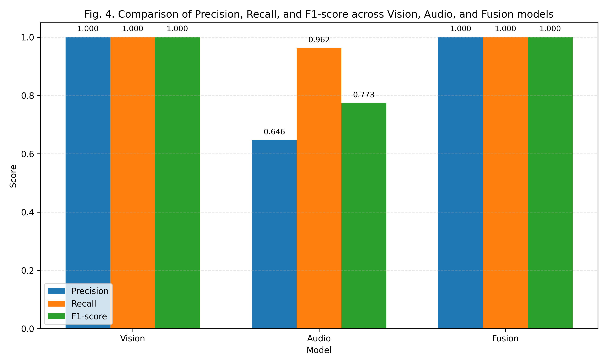
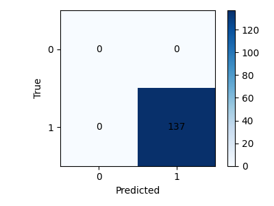
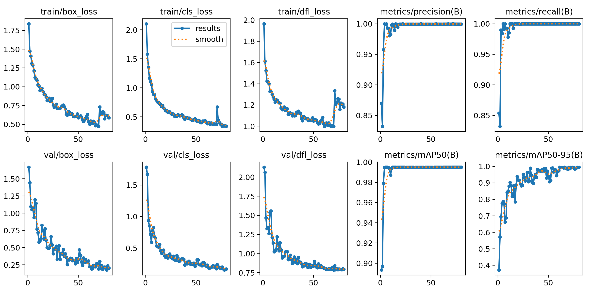
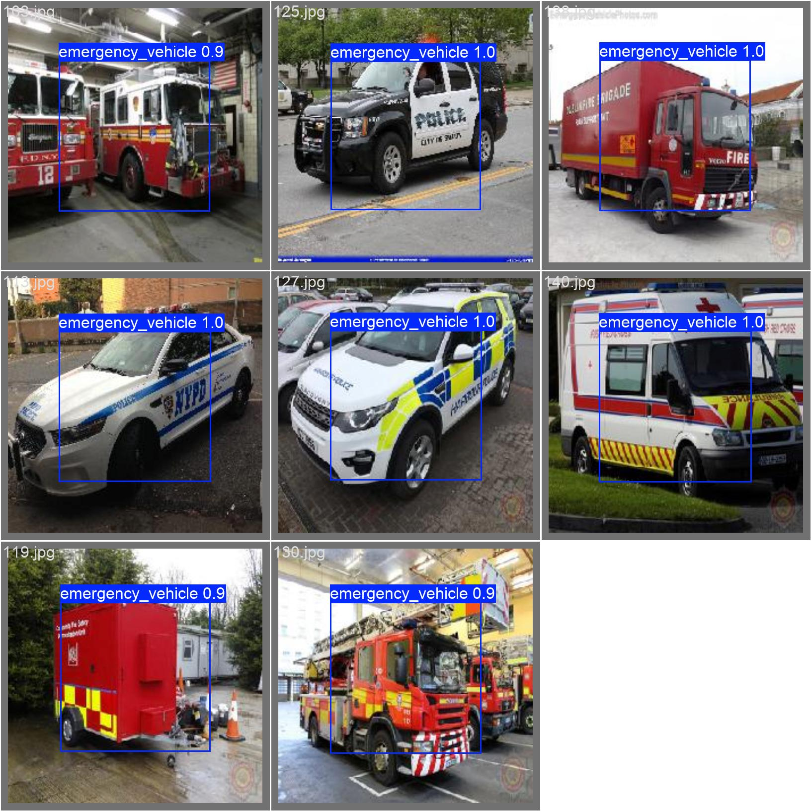

<div align="center">

# 🚑 Dynamic Modality Switching for Robust Emergency Vehicle Detection

**Seeing *and* hearing emergency vehicles — and trusting the right sense at the right moment.**


[Overview](#-overview) •
[How it works](#-how-it-works) •
[Results](#-results) •
[Quick start](#-quick-start) •
[Project structure](#-project-structure) •
[Limitations](#-limitations--honest-notes)

</div>

---

## 📌 Overview

A camera alone struggles at night, in fog or in heavy rain. A microphone alone struggles in loud, busy traffic. This project combines **both** into a single emergency-vehicle detector and **dynamically decides how much to trust each one** based on the surrounding conditions.

| Modality | Model | What it detects |
|---|---|---|
| 👁️ **Vision** | YOLOv8n (Ultralytics) | Emergency vehicles in images |
| 🔊 **Audio** | Custom 3-layer CNN on log-mel spectrograms | Siren sounds (UrbanSound8K) |
| 🧠 **Fusion** | Context-aware weighted late fusion | Final emergency / no-emergency decision |

---

## ✨ Features

- **YOLOv8 vision detector** fine-tuned for a single class: `emergency_vehicle`
- **Siren classifier** – compact CNN trained on 64-band log-mel spectrograms with SpecAugment, noise injection and class balancing
- **Context detection** – estimates *lighting* (day / night), *weather* (clear / rain / fog) and *traffic density* (low / medium / high) from the image using OpenCV
- **Dynamic modality switching** – audio and vision weights and the decision threshold change with the detected context
- **Confidence-aware fallback rules** – if one modality is confident and the other is unsure, the confident one can trigger an alert
- **Old vs. new fusion comparison** and an automatic **fusion parameter sweep** (threshold × weight scale)
- **Ready-made outputs** – metrics, confusion matrices, prediction CSVs and a comparison chart

---

## 🧠 How it works

```
            ┌────────────────┐        ┌───────────────────┐
  Image ───►│  YOLOv8n       │──────► │ vision confidence │──┐
     │      └────────────────┘        └───────────────────┘  │
     │                                                       │   ┌──────────────────────┐   ┌──────────────┐
     │      ┌────────────────┐        ┌───────────────────┐  ├──►│ Context-aware fusion │──►│ 🚨 Emergency │
     └─────►│ Context detect │──────► │ lighting/weather/ │──┤   │ weights + threshold  │   │   or ✅ Clear │
            │ (OpenCV)       │        │ traffic density   │  │   └──────────────────────┘   └──────────────┘
            └────────────────┘        └───────────────────┘  │
                                                             │
            ┌────────────────┐        ┌───────────────────┐  │
  Audio ───►│ Log-mel + CNN  │──────► │ siren probability │──┘
            └────────────────┘        └───────────────────┘
```

### 1. Context detection (`src/context.py`)

| Signal | How it is measured | Rule |
|---|---|---|
| **Lighting** | Mean grayscale brightness | `< 100` → night, otherwise day |
| **Weather** | Variance of the Laplacian (sharpness) | `< 60` → fog, `< 120` → rain, otherwise clear |
| **Traffic density** | Number of Canny-edge contours | `> 300` → high, `> 120` → medium, otherwise low |

### 2. Dynamic modality weighting (`src/fusion.py`)

| Condition | Audio weight | Vision weight | Decision threshold |
|---|:---:|:---:|:---:|
| 🌙 Night | 0.70 | 0.30 | 0.30 |
| 🌧️ Rain / fog | 0.60 | 0.40 | 0.32 |
| 🚗 High traffic | 0.65 | 0.35 | 0.33 |
| ☀️ Normal | 0.30 | 0.70 | 0.35 |

On top of the table, the weights are **adjusted by confidence**: if the vision confidence is below 0.4, audio gains +0.2; if the audio confidence is below 0.4, vision gains +0.2. Weights are then re-normalised to sum to 1.

```
fusion_score = vision_conf × vision_weight  +  audio_conf × audio_weight
emergency    = fusion_score ≥ threshold
               OR (audio ≥ 0.5 and vision < 0.3)     # vision blind, audio sure
               OR (vision ≥ 0.5 and audio < 0.3)     # audio drowned out, vision sure
```

### 3. Audio model (`src/audio_model.py`)

`Conv(1→16) → Conv(16→32) → Conv(32→64)` with BatchNorm, ReLU and pooling, followed by a small dropout-regularised classifier that outputs a single siren logit. Training uses `BCEWithLogitsLoss` with class weighting, a cosine learning-rate schedule and early stopping on validation F1.

---

## 📊 Results

Latest recorded evaluation run (`outputs/evaluation_results.txt`):

| Model | Precision | Recall | F1-score | Accuracy |
|---|:---:|:---:|:---:|:---:|
| 👁️ Vision (YOLOv8n) | 1.000 | 1.000 | 1.000 | 1.000 |
| 🔊 Audio (CNN) | 0.646 | 0.962 | 0.773 | 0.940 |
| 🧠 **Fusion (dynamic)** | **1.000** | **1.000** | **1.000** | **1.000** |

Vision detection quality: **mAP@0.5 = 0.995**.

**Old vs. new fusion** (`outputs/fusion_comparison.txt`):

| Fusion strategy | F1 | Recall |
|---|:---:|:---:|
| Old (fixed 4-rule weights, threshold 0.5) | 0.676 | 0.511 |
| **New (confidence-aware + dynamic threshold)** | **1.000** | **1.000** |

> 📝 See [Limitations](#-limitations--honest-notes) before reading too much into the perfect scores — they come from a small validation split.

### 📈 Figures

<div align="center">

| Precision / Recall / F1 across models | Fusion confusion matrix |
|:---:|:---:|
|  |  |

| YOLO training curves | YOLO validation predictions |
|:---:|:---:|
|  |  |

</div>

---

## 📁 Project structure

```
.
├── main.py                       # Entry point: train + evaluate the full pipeline
├── generate_performance_graph.py # Builds outputs/performance_comparison.png
├── ev_compact.py                 # Extended experiment toolkit (calibration, learned gate, robustness sweeps)
├── requirements.txt              # Python dependencies
├── vision.yaml                   # YOLO dataset config
│
├── src/
│   ├── vision_data.py            # Builds YOLO train/val split from the image CSV
│   ├── vision_train.py           # YOLOv8 training + evaluation
│   ├── audio_data.py             # UrbanSound8K manifests, log-mel dataset, augmentation
│   ├── audio_model.py            # AudioCNN architecture
│   ├── audio_train.py            # Audio training loop + evaluation
│   ├── context.py                # Lighting / weather / traffic estimation
│   ├── fusion.py                 # Dynamic fusion, tuning, old-vs-new comparison
│   ├── fusion_old.py             # Original fixed-weight fusion (baseline)
│   ├── dynamic_fusion.py         # Convenience re-exports from fusion.py
│   └── metrics.py                # Precision / recall / F1 / confusion matrix helpers
│
├── Emergency_Vehicles/           # Raw image dataset (train/, test/, train.csv, test.csv)
├── data/                         # Generated YOLO + audio splits
├── weights/                      # Trained models (yolov8n_emergency.pt, audio_cnn.pt)
├── runs/                         # Ultralytics training / validation artefacts
└── outputs/                      # Metrics, predictions, confusion matrices, charts
```

---

## 🚀 Quick start

### 1. Clone the repository

```bash
git clone https://github.com/siramansingh/Robust-Multimodal-Emergency-Vehicle-Detection-with-Dynamic-Modality-Switching.git
cd Robust-Multimodal-Emergency-Vehicle-Detection-with-Dynamic-Modality-Switching
```

### 2. Create an environment and install dependencies

```bash
python -m venv venv
source venv/bin/activate        # Windows: venv\Scripts\activate
pip install -r requirements.txt
```

> `requirements.txt` pins the **CUDA 11.8** builds of PyTorch (`+cu118`). On a CPU-only machine or Apple Silicon, install the matching PyTorch build from [pytorch.org](https://pytorch.org/get-started/locally/) first and remove those three `+cu118` lines from the file.

### 3. Get the audio dataset

Download **[UrbanSound8K](https://urbansounds.weebly.com/urbansound8k.html)** and extract it in the project root so the layout is:

```
UrbanSound8K/
├── audio/fold1 ... fold10/
└── metadata/UrbanSound8K.csv
```

The `siren` class is used as the positive label; every other class is negative.

### 4. Reset the audio manifests (important on a new machine)

The shipped files in `data/audio/` contain absolute paths from the original author's Windows machine. Delete them so they are regenerated for your computer:

```bash
rm data/audio/manifest.csv data/audio/train_manifest.csv data/audio/val_manifest.csv
# Windows (PowerShell): del data\audio\*manifest.csv
```

### 5. Train

```bash
# Full training (80 vision epochs, 30 audio epochs)
python main.py --train

# Quick smoke test
python main.py --train --epochs-vision 5 --epochs-audio 2
```

### 6. Evaluate

```bash
python main.py --evaluate
```

This prints vision, audio and fusion metrics, the best fusion setting, an old-vs-new fusion comparison and per-condition scores (day / night / rain), and writes everything to `outputs/`.

### 7. Regenerate the comparison chart

```bash
python generate_performance_graph.py
```

---

## ⚙️ Command-line options

| Flag | Default | Description |
|---|:---:|---|
| `--train` | – | Train the vision and audio models |
| `--evaluate` | – | Evaluate both models and the fusion stage |
| `--epochs-vision` | `80` | YOLO training epochs |
| `--epochs-audio` | `30` | Audio CNN training epochs |
| `--imgsz` | `640` | YOLO input image size |
| `--batch` | `0` (auto) | YOLO batch size |
| `--audio-batch` | `32` | Audio batch size |
| `--audio-lr` | `3e-3` | Audio learning rate |
| `--model-size` | `yolov8n` | `yolov8n`, `yolov8s` or `yolov8m` |
| `--freeze-backbone` | off | Freeze the YOLO backbone, fine-tune the head only |
| `--device` | auto | YOLO device, e.g. `0` for the first GPU |
| `--val-split` | `0.2` | Validation share for the datasets |
| `--vision-conf` | `0.05` | Confidence threshold used when evaluating vision |
| `--keep-vision-negatives` | off | Keep background-only images in the vision set |
| `--no-audio-balance` | off | Disable class-balanced sampling for audio |

---

## 📦 Outputs

| File | Contents |
|---|---|
| `outputs/evaluation_results.txt` | Appended metrics of every evaluation run |
| `outputs/training_log.txt` | Settings of every training run |
| `outputs/fusion_comparison.txt` | Old vs. new fusion F1 and recall |
| `outputs/fusion_tuning_results.txt` | Threshold × weight-scale sweep results |
| `outputs/*_predictions.csv` | Per-sample predictions (vision, audio, fusion) |
| `outputs/*_confusion_matrix.(csv/png)` | Confusion matrices |
| `outputs/performance_comparison.png` | Vision vs. audio vs. fusion bar chart |
| `weights/yolov8n_emergency.pt`, `weights/audio_cnn.pt` | Trained models |
| `runs/detect/...` | YOLO curves, batches and validation predictions |

---

## 🧪 Extended experiments (`ev_compact.py`)

`ev_compact.py` is a research-oriented toolkit that goes beyond the main pipeline. It contains:

- **Temperature scaling** and **expected calibration error** for comparable vision/audio probabilities
- A **learned reliability gate** (logistic regression over visual, acoustic and confidence features) as a replacement for the hand-tuned weight table
- **Synthetic degradations** — low light, fog, rain, motion blur, glare (vision) and traffic noise, wind noise, clipping (audio) at several severities
- A fusion baseline suite (vision-only, audio-only, mean, max, noisy-OR, static weighted, rule-based, learned late fusion, log-odds pooling, oracle gate), plus McNemar tests and LaTeX table export

---

## ⚠️ Limitations & honest notes

Being upfront about these makes the project more credible:

1. **Small, easy validation split.** Vision validation is about 137 images, and the vision F1 / mAP of 1.0 / 0.995 are likely optimistic. An earlier run recorded in `evaluation_results.txt` scored far lower (vision recall 0.029), so results are sensitive to training settings.
2. **Approximate bounding boxes.** The image dataset provides only an emergency / not-emergency label, so `vision_data.py` assigns every positive image the same default box (centred, 60 % × 60 %). The detector is effectively learning image-level classification, which also inflates mAP.
3. **Audio and vision are paired by position, not by real events.** The image and sound datasets are independent, so each image is matched with an audio clip by index (`idx % len(audio_preds)`). The fused label is positive if *either* sample is positive. Real, synchronised audio-visual recordings would be a much stronger test.
4. **Heuristic context detector.** Lighting, weather and traffic are guessed from brightness, sharpness and edge counts — useful, but not a true weather classifier.
5. **Hand-set fusion weights.** The weight table is tuned by hand; `ev_compact.py` explores a learned gate as a more principled alternative.
6. **Audio class imbalance.** Sirens are a small fraction of UrbanSound8K, so audio precision (0.646) is the weakest metric.

---

## 🔮 Future work

- Real-time detection from a live camera + microphone stream
- Mobile / edge deployment (TFLite, ONNX)
- Synchronised audio-visual dataset with true bounding-box annotations
- Learned reliability gate in the main pipeline instead of rule-based weights
- Direction and distance estimation of the approaching siren

---

## 🛠️ Tech stack

Python · PyTorch · Ultralytics YOLOv8 · OpenCV · Librosa · scikit-learn · NumPy · Pandas · Matplotlib

---

## 🙏 Acknowledgements

- [Ultralytics YOLOv8](https://github.com/ultralytics/ultralytics)
- [UrbanSound8K](https://urbansounds.weebly.com/urbansound8k.html) — J. Salamon, C. Jacoby and J. P. Bello
- Emergency Vehicles image dataset (`Emergency_Vehicles/`)

---

## 👨‍💻 Author

**siramansingh** — [@siramansingh](https://github.com/siramansingh)

If you find this project useful, please consider giving it a ⭐!
